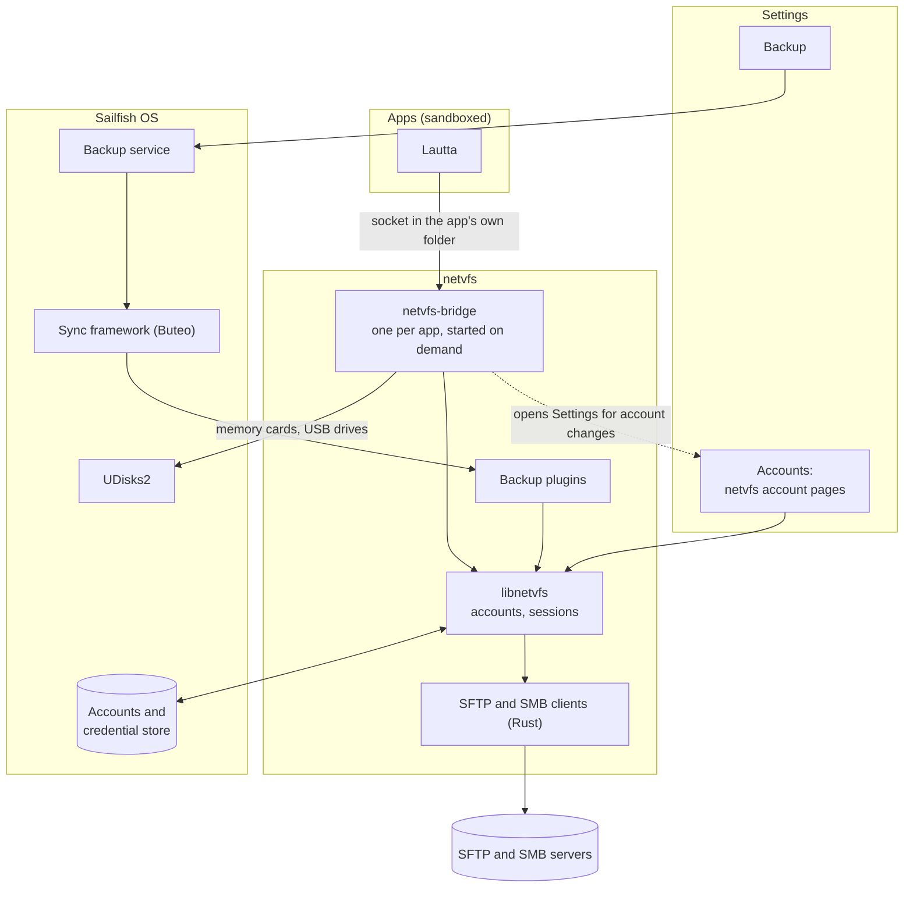

# netvfs

[](https://sonarcloud.io/summary/new_code?id=muhnschein_netvfs)[](https://sonarcloud.io/summary/new_code?id=muhnschein_netvfs)[](https://sonarcloud.io/summary/new_code?id=muhnschein_netvfs)[](https://sonarcloud.io/summary/new_code?id=muhnschein_netvfs)

> 🤖 **This project was developed using AI.** If that provenance troubles
> you, feel free to use something else.
>
> 📱 **Modern Sailfish OS only:** Sailfish OS 5.2 or later on aarch64.
> No effort is made to accommodate older targets.

## Overview

netvfs adds SFTP and SMB servers to Sailfish OS as a platform service:

- **Accounts.** SFTP and SMB appear in *Settings → Accounts*, next to the
  stock account types. Passwords and keys stay in the system's credential
  store.
- **Backups.** The same accounts appear as targets in *Settings → Backup*.
  Backup, scheduled backup and restore work as they do for Nextcloud.
- **Files for apps.** Sandboxed apps such as
  [Lautta](https://github.com/muhnschein/lautta) browse the servers through
  a bridge. They link nothing from netvfs, need no extra permission, and
  never see a secret.

The SFTP client is for OpenSSH servers; the SMB client speaks SMB 3.1.1 only
(Samba, Windows). Both are written in Rust.

## Where it sits



- An account is made and edited only in Settings. Apps hand off to Settings
  for that; the bridge never changes an account.
- The first time an app asks, netvfs posts a notification: allow or don't
  allow. *Settings → Accounts* lists the apps and can revoke them.
- The bridge serves one app over a socket in that app's own data folder,
  checks that the program on the other end is that app, and exits when idle.
  It reads and writes local files only through descriptors the app opened.
- A sandboxed app cannot mount drives, so the bridge also lists, mounts and
  unmounts memory cards and USB drives, as *Settings → Storage* does.

## Packages

| Package | For |
|---|---|
| `netvfs` | the accounts, the library, `netvfs-cli` |
| `netvfs-backup` | backups to SFTP and SMB (comes with `netvfs`, can be removed) |
| `netvfs-bridge` | apps such as Lautta |
| `netvfs-devel` | building against the library |

Install `netvfs`, `netvfs-backup` and `netvfs-bridge` from the same build, in
one go.

## Limitations

- No protocol or crypto of our own: the cryptography comes from established
  Rust crates.
- No Kerberos, no DFS, no SMB older than 3.1.1.
- No folder sync, no mounting servers as file systems.
- Not for the Jolla Store: it installs system files and a setgid helper.

## Building

The device packages, built in the Sailfish OS SDK image (needs Docker):

```
$ git clone https://github.com/muhnschein/netvfs.git
$ cd netvfs
$ git submodule update --init --depth 1
$ export SDK_IMAGE=mirror.gcr.io/coderus/sailfishos-platform-sdk-aarch64:5.2.0.15
$ export TARGET=SailfishOS-5.2.0.15-aarch64
$ tools/ci/build-rpm.sh
```

Everything else runs on the host:

```
# Host dependencies on Ubuntu 24.04.
$ ./tools/ci/install-host-deps.sh
$ ./tools/ci/cargo-tool.sh cargo-nextest 0.9.148

# Rust checks, C++ unit tests, bridge tests, and interop tests against
# OpenSSH and Samba containers (those need Docker).
$ make check
```

## Attributions

* [russh](https://github.com/Eugeny/russh), for SSH in Rust.
* [sspi-rs](https://github.com/Devolutions/sspi-rs), for NTLM sign-in.
* [ring](https://github.com/briansmith/ring) and
  [RustCrypto](https://github.com/RustCrypto), for the cryptography.
* Jolla's Nextcloud account, for showing how a backup account plugs into
  Sailfish OS.

## License

Licensed LGPL-2.1-or-later, see the LICENSE file for details.

Copyright © netvfs contributors.
